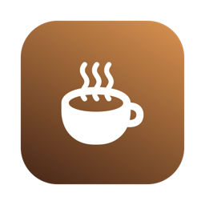
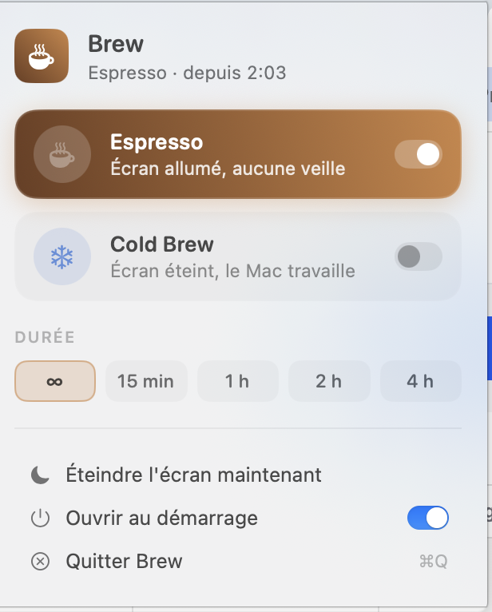

<p align="center">
  
</p>

<h1 align="center">Brew</h1>

<p align="center">
  <strong>Keep your Mac awake, one cup at a time.</strong><br>
  A tiny, native menu bar app for macOS. No dependencies, no Dock icon, no fuss.
</p>

<p align="center">
  
  
  
</p>

<p align="center">
  
</p>

---

## Two brews ☕

| | Mode | Screen | Mac | Perfect for |
|---|---|---|---|---|
| ☕ | **Espresso** | stays on | never sleeps | presentations, dashboards, reading, anything you're *looking at* |
| ❄️ | **Cold Brew** | can turn off | keeps running | long builds, downloads, AI agents and scripts working while you're away |

**Espresso** holds the same power assertion a video player takes in full screen (`PreventUserIdleDisplaySleep`), so your Mac behaves exactly as if you were watching YouTube.

**Cold Brew** steeps quietly in the dark: the display is free to sleep, but the system isn't (`PreventUserIdleSystemSleep`). Your processes keep going and your screen stays dark.

## Features

- **One click** to toggle a mode, and one more to turn it off
- **Timers**: ∞, 15 min, 1 h, 2 h, 4 h. Brew stops on its own when time's up
- **Live status** shows how long it's been brewing, or how long is left
- **Turn off the display now**, the perfect companion to Cold Brew
- **Open at login**
- Menu bar icon changes with the active mode
- Native SwiftUI with light & dark mode, all in ~300 KB

## Install

Requires macOS 14+ and the Xcode Command Line Tools (`xcode-select --install`).

```bash
git clone https://github.com/marcmend/brew.git
cd brew
./build.sh install   # builds Brew.app, copies it to /Applications and launches it
```

`./build.sh` alone builds `build/Brew.app` without installing it.

> The app is ad-hoc signed. If macOS complains on first launch, right-click **Brew.app → Open**.

## Good to know

- **Lid closed = sleep.** macOS always sleeps a MacBook when you close the lid, whatever app asks it not to. The only exception is clamshell mode (power plus an external display). To keep things running on a laptop, leave the lid open and use **Turn off the display now**.
- Brew releases its assertion on quit, on timer end, or when you switch modes. You can check what's active with:
  ```bash
  pmset -g assertions | grep Brew
  ```

## How it works

```
Sources/Brew/
├── BrewApp.swift   # MenuBarExtra entry point
├── Brewer.swift    # IOKit power assertions, timer, login item
└── MenuView.swift  # the UI
```

Brew is a thin layer over `IOPMAssertionCreateWithName`, which is the same API `caffeinate` uses, wrapped in a nicer cup.

---

<p align="center"><sub>Made with ☕ in France</sub></p>
